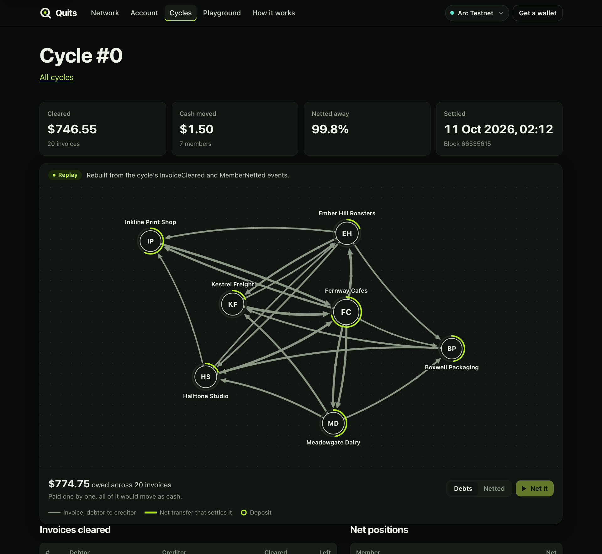
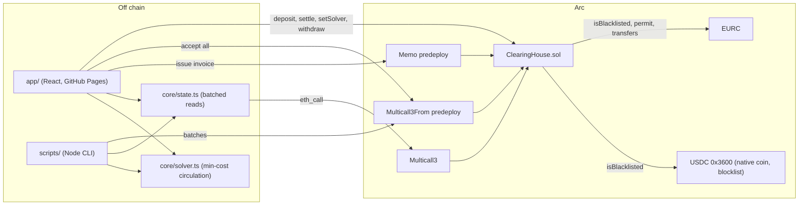

# Quits

**A clearing house for invoices on Arc: businesses that owe each other in loops settle only the difference, in one
atomic USDC transaction.**

Built for the Arc Microgrants program (Circle and DoraHacks). **[Watch the 2-minute demo](https://sanchay117.github.io/quits/demo.mp4)**: motion graphics rendered from the live Arc Mainnet data.



**Try it in 60 seconds** at [sanchay117.github.io/quits](https://sanchay117.github.io/quits/), no wallet needed:
open **Network** and press *Compute netting* to watch the open invoices collapse into a few transfers; open **Cycles**
to replay a settled cycle from its on-chain events; open **Playground** to net random networks in your browser; on
Network, click a company to see its account read-only.

## The idea in one example

```
A owes B $100        Paid one by one: $300 changes hands, and each business needs $100 of cash first.
B owes C $100
C owes A $100        Netted by Quits: all three invoices are cleared and $0 moves.
```

If C owed A only $80, Quits would still clear all $280 of debt, and only A would pay: $20 to C. Every business ends
up exactly where paying in full would have left it, with a fraction of the cash.

Trade between small businesses creates these loops: a roaster owes its packaging supplier, who owes a freight firm,
who owes the cafe chain that buys the roaster's beans. Stock markets solved this decades ago with central clearing.
Small businesses still pay every invoice in full.

## What it does

- **Invoices on chain.** A creditor issues an invoice (amount, due date, its own reference, a memo of up to 140
  bytes). The debtor accepts or rejects it. Only accepted invoices that are due can ever be cleared.
- **Deposits.** Each member keeps a small deposit in USDC (sent as Arc's native coin) or EURC. A deposit only ever pays
  net positions.
- **Netting.** An exact solver clears as much debt as possible, then moves as little cash as possible. It runs in the
  browser and in the scripts.
- **Settlement.** `settle()` re-checks every rule on chain and moves only each member's net difference, all or
  nothing, in one transaction.
- **Consent.** A cycle can take cash from a member's deposit only if the member sent it or approved the sender (or
  anyone) with `setSolver`. Cash-free loops need no approval.
- **Compliance.** A member on USDC's blocklist (Arc's chain-level list), or on EURC's for EURC, cannot take part in a
  cycle or withdraw.
- **A web app** with six pages: Home (live totals and the latest cycle collapsing into its net transfers), Network
  (live debt graph, "Compute netting" in the browser, "Settle on Arc" from your wallet), Account (name, deposits,
  netting permissions, issue and accept invoices, CSV export), Cycles (every settled cycle, with a replay),
  Playground (random networks through the same solver, no wallet) and How it works.

## Links

| | |
|---|---|
| Web app | https://sanchay117.github.io/quits/ (reads Arc Mainnet by default; [`?network=testnet`](https://sanchay117.github.io/quits/?network=testnet) for the testnet deployment) |
| Source | https://github.com/Sanchay117/quits |
| Arc Mainnet contract | [`0x3ac6634C02ae6428BcFE4C5024dA18Aaf598aac1`](https://explorer.arc.io/address/0x3ac6634C02ae6428BcFE4C5024dA18Aaf598aac1), source [verified on Sourcify](https://repo.sourcify.dev/5042/0x3ac6634C02ae6428BcFE4C5024dA18Aaf598aac1) and on Arc Explorer |
| First mainnet cycle | [20 invoices, $74.66 cleared with $0.15 of cash](https://explorer.arc.io/tx/0x49e714b491b771a1ae941ca93b201f5b8889f775d2b86f2673c07dd072453f01) (the demo runs at a tenth of the testnet amounts to keep the float small; [docs/MAINNET.md](docs/MAINNET.md)) |
| Arc Testnet contract | [`0xcf711Fbbc8938F7740615a97dc9b66149cd5e704`](https://explorer.testnet.arc.io/address/0xcf711Fbbc8938F7740615a97dc9b66149cd5e704), source [verified on Sourcify](https://repo.sourcify.dev/5042002/0xcf711Fbbc8938F7740615a97dc9b66149cd5e704) |
| Testnet rehearsal | [docs/TESTNET.md](docs/TESTNET.md): all 38 transactions with explorer links and their cost |
| Security notes | [docs/SECURITY.md](docs/SECURITY.md) |
| Build spec | [docs/SPEC.md](docs/SPEC.md) |

On Arc Testnet, the first netting cycle ([tx](https://explorer.testnet.arc.io/tx/0xcf46664dc6084f901bd6b4d2cd02bb76b8465242b9b432000e62a9021066d207))
cleared 20 invoices worth $746.55 among 7 companies with $1.50 of cash: 99.8% of the value never moved. The network
it ran on is our own: seven simulated small businesses whose wallets we control, seeded by our scripts, not
customers. The invoices are designed around loops, so the percentage shows the mechanism, not a market statistic.

## Why Arc

Each point below is something the code depends on, not a general claim about Arc. The testnet run in
[docs/TESTNET.md](docs/TESTNET.md) exercised all of them except EURC.

- **USDC is the native coin.** `deposit()` is `payable`: a USDC deposit is one plain transaction carrying `msg.value`,
  with no approval step, and withdrawals are native sends. The contract converts between the 18 decimals of native
  value and the 6-decimal units of the USDC ERC-20 view at `0x3600...0000`, and rejects deposits that are not a whole
  number of 6-decimal units.
- **Deterministic finality.** A cycle is final in the block that includes it: no reorgs, no confirmation counts. A
  clearing house exists to give settlement finality, and Arc gives it at the chain level. The app reports a cycle as
  "settled and final" from its first receipt.
- **The blocklist is part of the clearing rules.** For every member a cycle touches, `settle()` calls
  `isBlacklisted` on the cycle's token and on USDC (Arc's chain-level blocklist), and `withdraw()` applies the same
  rule. On Arc Testnet, `isBlacklisted(0x70997970C51812dc3A010C7d01b50e0d17dc79C8)` on USDC returns true, which is the
  view the contract reads.
- **Memo predeploy.** The app issues invoices through Arc's Memo contract (`0x5294...e505`), so each invoice's
  reference is indexed in a `Memo` event next to the clearing house's own event. The seed's first invoice went through
  it on testnet ([tx](https://explorer.testnet.arc.io/tx/0xe8c9d6787b0ba3e582944eaf8da693d91bb3250d8ba3099d5fd6ea7a7042e7f7)).
- **Multicall3From predeploy.** Batches in which every call runs as the sending wallet (`0x522f...47D0`): the app's
  "Accept all", and in the scripts each company's register, `setSolver` and invoices in one transaction, plus the
  deployer's funding transfers. 16 of the 38 testnet transactions are such batches, and their events name the
  sending wallet as `msg.sender`.
- **EURC.** Circle's EURC is the second token, fixed in the constructor. EURC invoices net in their own cycles, and
  the app deposits EURC with an EIP-2612 permit in one transaction. The demo network itself runs in USDC only.
- **Gas is cheap and priced in USDC (measured).** At Arc's 20 gwei base fee plus a 1 gwei tip, the 20-invoice testnet
  cycle cost 611,121 gas, $0.0128. The whole testnet demo (deploy, funding, 21 invoices issued and accepted, one
  cycle, a second round of invoices) was 38 transactions for $0.22. The largest cycle one call accepts (256 invoices,
  512 members) measures 16.6M gas on the local token mocks, about 17.5M once Arc's costlier blocklist reads are
  counted: about $0.35, under 60% of a 30M-gas block.

## The DTCC comparison

In US equities, the NSCC (part of DTCC) nets every member's trades so that only the differences are paid. DTCC
reports that this multilateral netting reduces equities payment obligations by an average of 98%
([dtcc.com](https://www.dtcc.com/products-and-services/clearing-settlement-services/equities-clearing)). On an average
day in 2020, $1.77 trillion of trade activity netted down to just under $38 billion of final settlement
([dtcc.com](https://www.dtcc.com/dtcc-connection/articles/2021/april/19/ask-the-expert-same-day-every-day-how-same-day-settlement-works-at-dtcc)).

That service is for clearing members of a market infrastructure. Quits applies the same idea to invoices between
any businesses on Arc: open to anyone with a wallet, settled atomically, with the rules in one public contract.

## Architecture



| Path | What it is |
|---|---|
| [`contracts/`](contracts/) | Foundry project. [`src/ClearingHouse.sol`](contracts/src/ClearingHouse.sol) is the only contract: about 600 lines with comments, no owner, no admin, no upgrades, no fees. Tests, gas report, deploy script. |
| [`core/`](core/) | TypeScript shared by the app and the scripts, no build step: the netting solver, batched state reads (`loadState`), Arc network constants, the generated ABI and the deployed addresses. |
| [`app/`](app/) | Vite and React 19 static site. No backend: it reads the chain through a public RPC and sends transactions from an injected wallet (it can add Arc to the wallet). Choose the network with `?network=testnet` or `?network=local` (default mainnet). |
| [`scripts/`](scripts/) | Node scripts run as `node scripts/<name>.ts`: local chain setup, deploy, verify, demo wallets, fund, seed, cycle, status, recover. On mainnet every script that sends prints its plan and cost, and sends nothing without `--yes`. |
| [`docs/`](docs/) | [SPEC](docs/SPEC.md), [SECURITY](docs/SECURITY.md), [TESTNET](docs/TESTNET.md). |

The split is deliberate: the optimisation runs off chain, where it is cheap, and the contract only checks that a
proposed cycle is valid. A weaker solution still settles correctly; it just clears less.

## Netting rules

`settle(token, ids, amounts)` takes an amount to clear on each of up to 256 invoices. The contract checks:

1. Each invoice is accepted (Open), in `token`, due (`block.timestamp >= dueDate`), and `0 < amount <= outstanding`.
   Ids are strictly ascending, so none repeats.
2. It adds up each member's net over the cycle: what it is owed minus what it owes on the cleared amounts.
3. Every member touched must be off the token's blocklist and off USDC's.
4. Every member with a negative net (a payer) must consent to the sender (below), and its deposit must cover its net.
5. Payers are debited and receivers credited by exactly their nets, so no money is created or destroyed. Invoices
   that reach zero become Paid.

If any check fails the whole cycle reverts: it never settles half way.

**The solver** ([`core/solver.ts`](core/solver.ts)) maximises the debt cleared and, among those solutions, minimises
the cash moved, subject to each payer's deposit. It models the problem as a minimum-cost circulation with a cash node
(cost 1 per unit drawn from a deposit, 2 per unit left uncleared; the header comment proves why a weight of 2 gives
exactly this order) and solves it with successive shortest paths using integer (bigint) arithmetic only. The tests
check it against a linear-programming solver on 300 random networks and against brute force on 3,000 tiny ones, and
assert that it solves 300 invoices among 100 members in under a second. `checkSolution()` mirrors `settle()`'s
checks, so the app and the scripts validate a cycle before anyone signs.

**Solver consent.** An earlier version let anyone choose which debts a cycle cleared. That allowed cherry-picking: if
A owes B $50 and B owes A $50, B could submit only A's debt, leave out its own, and take $50 of cash from A's deposit
instead of netting to zero. Now a member whose net in a cycle is negative must be the sender, or have approved the
sender with `setSolver(solver, true)`, or have approved anyone with `setSolver(address(0), true)`; otherwise
`settle()` reverts with `PayerNotConsenting`. Members whose net is zero or positive need no approval, so anyone can
still settle a pure loop of debt. An approved solver still chooses which of the member's due debts its cash pays, so
approval is trust in that solver. The demo companies approve anyone, so reviewers can settle cycles from the app.

## Security

- No owner, no admin, no upgrade path, no fees. The supported tokens (USDC and EURC) are fixed at deployment.
- **176 Foundry tests, all passing:** 170 unit tests, 5 fuzz tests (2,000 runs each) and a stateful invariant suite
  that checks 7 invariants over 32,000 random calls against an independent model of balances and statuses.
- The properties tested include: the ledger always equals deposits minus withdrawals; the contract's real holdings
  always cover it; each member moves by exactly its net; a pure loop settles with zero deposits whoever submits it;
  cash leaves a deposit only with its owner's consent.
- An adversarial review found the cherry-picking issue (fixed by solver consent, above) and a set of low-severity
  and informational items, which are acknowledged with their reasoning. Every finding, the threat model and the gas
  measurements are in **[docs/SECURITY.md](docs/SECURITY.md)**.

## Run it locally

You need Node 24 (22.18 or later runs the `.ts` scripts directly), pnpm and Foundry (`forge`, `anvil`).

```sh
pnpm install

# Terminal 1: a local chain
anvil --chain-id 31337

# Terminal 2, from the repository root
node scripts/local-chain.ts      # Arc-like USDC view and Multicall3, mock EURC, ClearingHouse; records them in core/deployments.ts
node scripts/wallets.ts          # seven demo companies in .secrets/local-companies.json (never overwritten)
node scripts/fund.ts             # the deployer (anvil's account 0) sends each company USDC for gas and deposits
node scripts/seed.ts             # round 1: register, setSolver(anyone), issue 21 invoices, deposit, accept
node scripts/cycle.ts            # solve, print the plan, check it, settle()
node scripts/seed.ts --round 2   # the next week's invoices, left open for the app
node scripts/status.ts           # members, deposits, consent, open invoices, cycles, totals

# The app
cd app && pnpm dev               # open the printed URL with ?network=local
```

Run any of them with `--help` for its options. Apart from `local-chain.ts`, they take
`--network mainnet|testnet|local` (default `local`), and the ones that send transactions also take `--dry-run`.
`cycle.ts --from "Fernway Cafes"` submits as a company instead of the deployer, and `status.ts --submitter <name>`
shows the netting preview for cycles sent by that account. Anvil has no Memo or Multicall3From, so locally
the scripts send one transaction per call. On a fresh local chain the first cycle clears $746.55 with $1.50 of
cash, as on testnet.

To read the testnet deployment without a key: `node scripts/status.ts --network testnet`, or open the app with
`?network=testnet`.

## Tests

```sh
(cd contracts && forge test)                  # 176 tests: unit, fuzz and the invariant suite
pnpm vitest run core/                         # 57 tests: solver 35, consent 13, state 9
(cd app && pnpm exec vitest run)              # 102 tests in 15 files
pnpm tsc --noEmit -p tsconfig.json            # typecheck core and scripts
(cd app && pnpm exec tsc --noEmit -p tsconfig.json)
```

Counts are from a run on 2026-10-11: all passed and both typechecks were clean. CI
([.github/workflows/ci.yml](.github/workflows/ci.yml)) runs the same checks, plus the app build, on every push to
`main` and on pull requests.

## Limitations

- **The demo network is ours.** Its seven companies are simulated businesses with wallets we control, not customers.
- **Small mainnet amounts.** The mainnet demo runs at a tenth of the testnet amounts (`--scale 0.1`) so the float
  stays near one dollar; the netting shape and the 99.8% are the same.
- **No credit.** Deposits are prefunded and a member pays only from its own deposit. There is no lending and no
  default process: an accepted invoice clears only as far as netting and the debtor's deposit allow, and the rest
  waits.
- **Everything is public.** Arc's privacy features are not live yet, so names, amounts, references and memos are
  visible on chain.
- **One token per cycle.** USDC and EURC invoices net separately; there is no FX.
- **Trust in approved solvers.** A solver a member approves (or anyone, if it allows anyone) picks which of the
  member's due debts its cash pays. A per-cycle signed authorization would remove that trust and was not adopted yet.
- **Griefing.** Anyone can front-run a cycle with a tiny valid one that touches the same invoices, so the larger one
  reverts. Nothing is stolen and the next cycle uses the new amounts; the tooling simulates right before sending but
  does not retry automatically.
- **Headline totals can be inflated** by throwaway addresses invoicing each other in loops. The app does not filter
  them yet.
- **256 invoices per call.** The scripts refuse a larger solution; the app can settle the 256 oldest due invoices
  first. Automatic batch planning is not implemented.
- **No release of an accepted invoice.** Once accepted it stays open until cleared; a creditor-only release is the
  planned addition.
- **Stray funds are lost.** USDC or EURC sent to the contract other than through its deposit functions is credited to
  no one, and with no admin it cannot be recovered.

## What comes next

Built on Arc and Circle pieces that already exist:

- **Circle Wallets** so a business joins with an email or passkey instead of MetaMask.
- **CCTP and Gateway** so a member funds its deposit with USDC from any chain.
- **StableFX** for cross-currency cycles: a EUR debt and a USD debt in the same loop net against each other, which
  removes today's one-token-per-cycle limit.
- **Arc's opt-in privacy** (once live) for confidential invoice amounts and counterparties.
- A hosted solver that settles every few minutes for members who approve it.

Contract side: batch planning beyond 256 invoices per call, a creditor release for accepted invoices, and filtering
wash cycles out of the headline numbers. Product side: import and export with accounting software (the app already
exports invoices and clearing history as CSV).

## Prior art

Multilateral netting is how clearing houses work (DTCC's NSCC, CLS for FX). On chain, the
[Cycles protocol](https://arxiv.org/abs/2507.22309) (an Informal Systems spin-out on Cosmos) applies trade-credit set-off
to private OTC netting for trading firms. Quits is different in where and for whom: open and on chain on Arc, for any
business holding USDC or EURC, with every cycle verified by the contract, settled atomically with deterministic
finality, screened against Circle's blocklist, and drawing cash only with each member's consent.

## License

MIT.
